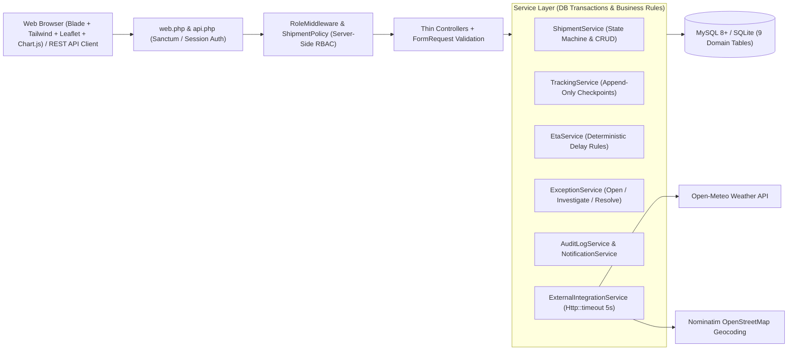

# CargoTrace — KilatLogix Express (KLX)

**Global Shipment Visibility & Real-Time Cargo Tracking Platform** built with PHP 8.2+/8.3+, Laravel 12, MySQL 8+ / SQLite, Laravel Sanctum, Tailwind CSS, Chart.js, and Leaflet.js + OpenStreetMap.

---

## 1. Problem Statement & Solution

Global logistics operations frequently suffer from fragmented shipment status updates, lack of deterministic delay visibility, silent operational exceptions (customs holds, weather disruptions, port congestion), and weak data isolation between internal staff and external customers.

**CargoTrace — KilatLogix Express (KLX)** solves these challenges by delivering:
- A **Strict Service-Layer Architecture** separating thin HTTP controllers from business logic and atomic database transactions (`DB::transaction`).
- An **Append-Only Historical Tracking Ledger** coupled with a **Shipment Lifecycle State Machine** (`CREATED` → `BOOKED` → `PICKED_UP` → `IN_TRANSIT` → `DELIVERED`).
- **Deterministic ETA & Delay Evaluation** (`EtaService`) comparing `estimated_arrival` against `expected_arrival` and classifying delay severity (`1–6h: LOW`, `>6–24h: MEDIUM`, `>24h: HIGH`).
- **Role-Based Access Control (RBAC)** with 3 completely distinct role-tailored UIs (`admin`, `operator`, `customer`), server-side Policies/Middleware, and a public waybill lookup portal (`/track`).
- **Interactive Route Mapping & Weather Telemetry** via **Leaflet.js + OpenStreetMap**, **Open-Meteo Weather API**, and **Nominatim Geocoding API** with resilient 5-second timeout fallbacks.

---

## 2. Core Features

- **3 Role-Specific Workspaces:**
  - **Administrator (`layouts/admin.blade.php`):** Executive Dark Slate & Indigo dashboard with Chart.js KPI visualizations, user/role management, carrier & location CRUD (with Nominatim geocoder), delay threshold settings, and full `audit_logs` explorer.
  - **Staff / Logistics Operator (`layouts/operator.blade.php`):** High-contrast Teal/Blue hub desk featuring quick waybill registration, "Scan / Update Tracking Checkpoint" panel, priority delayed/exception queue, and exception lifecycle resolution (`OPEN` → `INVESTIGATING` → `RESOLVED`).
  - **Customer (`layouts/customer.blade.php`) & Public Tracking (`/track`):** KilatLogix Express Vibrant Orange (`#FF5500`) & Deep Navy (`#0F172A`) consumer portal with strict data isolation (`customer_id === auth()->id()`), waybill search, 5-step progress stepper, interactive map, live weather card, and in-app notifications.
- **Multi-Filter & Paginated Shipment Directory:** Search by waybill/cargo, filter by status, carrier, origin, destination, date range, and delay status, sort by newest/oldest/ETA/delay hours, with server-side pagination.
- **Sanctum REST API:** Token-based authentication and full JSON API with FormRequest validation, API Resources, and clean error payloads (no stack trace leaks).

---

## 3. Tech Stack

| Layer | Technology |
| :--- | :--- |
| **Backend** | PHP 8.2+ / 8.3+, Laravel 12, Eloquent ORM, Laravel Sanctum |
| **Database** | MySQL 8+ (Production), SQLite (Local / In-Memory Testing) |
| **Frontend** | Blade Templates, Tailwind CSS, Vanilla JavaScript + Fetch API |
| **Data Viz & Maps** | Chart.js 4, Leaflet.js 1.9, OpenStreetMap Tiles |
| **External APIs** | Open-Meteo Forecast API, Nominatim OpenStreetMap Geocoding API |
| **Testing & QA** | PHPUnit 11, Laravel HTTP Fakes, Postman v2.1 Collection |

---

## 4. System Architecture Diagram



---

## 5. Entity Relationship Diagram (ERD) & Data Dictionary


### Data Dictionary (9 Domain Tables)

| Table | Purpose | Key Columns & Constraints |
| :--- | :--- | :--- |
| `users` | Platform accounts across all 3 roles | `id` (PK), `email` (UNIQUE), `role` (`admin`/`operator`/`customer`, INDEX), `phone`, `company_name` |
| `carriers` | Logistics carriers & transport modes | `id` (PK), `code` (UNIQUE), `transport_mode` (`AIR`/`SEA`/`ROAD`/`RAIL`), `is_active` |
| `locations` | Hubs, ports, airports & warehouses | `id` (PK), `code` (UNIQUE), `type`, `latitude` (`decimal 10,7`), `longitude` (`decimal 10,7`) |
| `shipments` | Core waybill, schedule & delay metrics | `id` (PK), `shipment_number` (UNIQUE), FKs to `users`/`carriers`/`locations`, `current_status`, `is_delayed`, `delay_hours`, `delay_severity`, `deleted_at` |
| `shipment_items` | Line-item cargo manifest | `id` (PK), `shipment_id` (FK cascade), `item_name`, `sku`, `quantity`, `weight_kg`, `declared_value` |
| `tracking_events` | Append-only chronological tracking ledger | `id` (PK), `shipment_id` (FK cascade), `location_id` (FK nullable), `created_by` (FK), `status`, `event_time`, `latitude`, `longitude`, `is_exception` |
| `shipment_exceptions` | Customs, weather, port & cargo incidents | `id` (PK), `shipment_id` (FK cascade), `reported_by` (FK), `resolved_by` (FK nullable), `exception_type`, `severity`, `status`, `detected_at`, `resolved_at` |
| `notifications` | In-app customer alert inbox | `id` (PK), `user_id` (FK cascade), `shipment_id` (FK nullable), `title`, `message`, `type`, `is_read` |
| `audit_logs` | Immutable governance & state-change trail | `id` (PK), `user_id` (FK nullable), `action`, `entity_type`, `entity_id`, `old_values` (JSON), `new_values` (JSON), `ip_address` |

---

## 6. Setup Instructions (Local Development)

1. **Clone the repository:**
   ```bash
   git clone https://github.com/zahrapradiza/Project-CargoTrace_Kilatlogix-Express.git
   cd Project-CargoTrace_Kilatlogix-Express
   ```
2. **Install dependencies & configure environment:**
   ```bash
   composer install
   cp .env.example .env
   php artisan key:generate
   ```
   Configure `DB_*` in `.env` for MySQL 8+ (or set `DB_CONNECTION=sqlite` for instant local SQLite).
3. **Run migrations & seed realistic demo data:**
   ```bash
   php artisan migrate:fresh --seed
   ```
4. **Start the application:**
   ```bash
   php artisan serve
   ```
   Visit `http://127.0.0.1:8000` (Public Tracking) or `http://127.0.0.1:8000/login` (Portal Sign In).

### Demo Credentials (Password: `password`)

| Role | Email | Workspace URL |
| :--- | :--- | :--- |
| **Administrator** | `admin@kilatlogix.test` | `/admin/dashboard` |
| **Staff / Operator** | `staff@kilatlogix.test` | `/operator/dashboard` |
| **Customer 1** | `customer1@kilatlogix.test` | `/customer/dashboard` |
| **Customer 2** | `customer2@kilatlogix.test` | `/customer/dashboard` |

Sample waybills for `/track`: `KLX-2026-0001`, `KLX-2026-0002`, `KLX-2026-0003`, `KLX-2026-0004`.

---

## 7. Testing Guide & Postman Collection

Run the automated PHPUnit test suite (`tests/Feature/CargoTraceTest.php` and modular feature tests):
```bash
php artisan test
```
Tests verify:
- Valid/invalid Sanctum login and unauthenticated access blocking (`401` API / `302` Web).
- Server-side RBAC (`403 Forbidden` when Customer tries creating shipments or viewing another Customer's shipment).
- State machine integrity (`DELIVERED` → `IN_TRANSIT` / `BOOKED` rejected with `422 Unprocessable Entity`, chronological `event_time` enforcement).
- Deterministic `EtaService` delay hours and `LOW` / `MEDIUM` / `HIGH` severity classification.
- Graceful external API fallback when weather providers return errors or time out.

Import [`docs/postman_collection.json`](docs/postman_collection.json) into Postman (v2.1) to test all 19 REST API endpoints under `/api/*`.

---

## 8. Production Deployment Guide

1. Set `APP_ENV=production`, `APP_DEBUG=false`, and a strong `APP_KEY` in `.env`.
2. Point `DB_CONNECTION=mysql` to a MySQL 8+ instance and run `php artisan migrate --force`.
3. Optimize framework caches:
   ```bash
   composer install --no-dev --optimize-autoloader
   php artisan config:cache
   php artisan route:cache
   php artisan view:cache
   ```
4. Configure Nginx or Apache (e.g., XAMPP VirtualHost) with document root pointed strictly to the `/public` directory and HTTPS enabled.

---

## 9. Attribution & License

- **Map Tiles & Geocoding:** [OpenStreetMap](https://www.openstreetmap.org/copyright) & [Nominatim](https://nominatim.openstreetmap.org/)
- **Interactive Mapping:** [Leaflet.js](https://leafletjs.com/)
- **Live Weather Telemetry:** [Open-Meteo](https://open-meteo.com/)
- **Analytics Charts:** [Chart.js](https://www.chartjs.org/)
- **Backend Framework:** [Laravel](https://laravel.com/)
