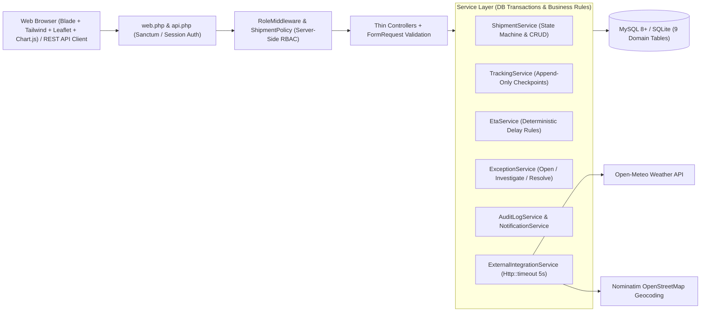
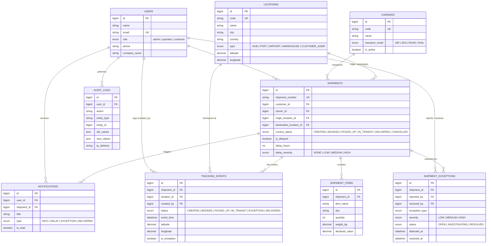

# CargoTrace — KilatLogix Express (KLX)

**Global Shipment Visibility & Real-Time Cargo Tracking Platform** built with PHP 8.2+/8.3+, Laravel 12, MySQL 8+ / SQLite, Laravel Sanctum, Tailwind CSS, Chart.js, and Leaflet.js + OpenStreetMap.

---

## 1. Problem Statement & Objectives

Global logistics operations frequently suffer from fragmented shipment status updates, lack of deterministic delay visibility, silent exceptions (customs holds, weather disruptions, port congestion), and weak data isolation between internal staff and customers.

**CargoTrace — KilatLogix Express (KLX)** solves these challenges by providing:
- A strict **Service-Layer Architecture** that separates HTTP controllers from business rules and database transactions.
- An **Append-Only Historical Tracking Ledger** coupled with a **Shipment Lifecycle State Machine** (`CREATED` → `BOOKED` → `PICKED_UP` → `IN_TRANSIT` → `DELIVERED`).
- **Deterministic ETA & Delay Evaluation** (`EtaService`) that compares `estimated_arrival` vs `expected_arrival` against a configurable threshold (`CARGOTRACE_DELAY_THRESHOLD_HOURS=12`) and classifies severity (`LOW: 1–6h`, `MEDIUM: >6–24h`, `HIGH: >24h`).
- **Role-Based Access Control (RBAC)** with 3 tailored visual workspaces and strict server-side policies/middleware (`admin`, `operator`, `customer`), plus a public waybill lookup portal (`/track`).
- **Interactive Global Route Map** powered by **Leaflet.js + OpenStreetMap**, with **Open-Meteo** live weather telemetry and **Nominatim** geocoding (with resilient offline fallbacks).

---

## 2. Role-Based Workspaces & Access Control

| Role | Theme | Key Capabilities |
| :--- | :--- | :--- |
| **Administrator (`admin`)** | Executive Dark Slate & Indigo Sidebar (`layouts/admin.blade.php`) | Executive KPI dashboard with Chart.js analytics, user & role management, CRUD carriers & locations (with Nominatim geocoder), system threshold inspection, and full `audit_logs` explorer. |
| **Logistics Operator (`operator`)** | High-Contrast Teal/Blue Hub Desk (`layouts/operator.blade.php`) | Hub dispatch queue, register new waybills (`KLX-YYYY-XXXX`), append chronological tracking checkpoints, log & resolve shipment exceptions, update ETA schedules. |
| **Customer (`customer`)** | KilatLogix Vibrant Orange (`#FF5500`) & Deep Navy Portal (`layouts/customer.blade.php`) | Strict isolation (`customer_id === auth()->id()`). Search own waybills, view step-by-step progress bar, inspect timeline & interactive route map, view live weather, and read in-app notifications. |
| **Public Guest (`/track`)** | Consumer Tracking Landing Page (`public/track.blade.php`) | Track any waybill number (e.g., `KLX-2026-0001`) with live route map & timeline without exposing private customer details. |

---

## 3. System Architecture Diagram



---

## 4. Entity Relationship Diagram (ERD)



---

## 5. Setup & Installation Instructions

### Prerequisites
- PHP 8.2+ (or 8.3+) with `pdo_mysql`, `pdo_sqlite`, `curl`, `mbstring`, `openssl`, `zip`
- Composer 2+
- MySQL 8+ (or SQLite for quick local evaluation)

### Steps
1. **Clone the repository:**
   ```bash
   git clone https://github.com/zahrapradiza/Project-CargoTrace_Kilatlogix-Express.git
   cd Project-CargoTrace_Kilatlogix-Express
   ```
2. **Install PHP dependencies:**
   ```bash
   composer install
   ```
3. **Configure environment:**
   ```bash
   cp .env.example .env
   php artisan key:generate
   ```
   Update `DB_*` variables in `.env` for your MySQL 8 database (or set `DB_CONNECTION=sqlite` for zero-config SQLite). Ensure `CARGOTRACE_DELAY_THRESHOLD_HOURS=12` is set as desired.
4. **Run database migrations & seed realistic demo data:**
   ```bash
   php artisan migrate:fresh --seed
   ```
5. **Start the local development server:**
   ```bash
   php artisan serve
   ```
   Open `http://127.0.0.1:8000` (Public Tracking) or `http://127.0.0.1:8000/login` (Portal Sign In).

---

## 6. Demo Credentials

All seeded demo accounts use the password: **`password`**

| Role | Email | Workspace URL |
| :--- | :--- | :--- |
| **Administrator** | `admin@kilatlogix.test` | `/admin/dashboard` |
| **Staff / Operator** | `staff@kilatlogix.test` | `/operator/dashboard` |
| **Customer 1** | `customer1@kilatlogix.test` | `/customer/dashboard` |
| **Customer 2** | `customer2@kilatlogix.test` | `/customer/dashboard` |

Sample seeded waybills for testing `/track`: `KLX-2026-0001`, `KLX-2026-0002`, `KLX-2026-0003`, `KLX-2026-0004`.

---

## 7. REST API & Postman Collection

Import [`docs/postman_collection.json`](docs/postman_collection.json) into Postman (v2.1) to test all Sanctum endpoints:
- **Auth:** `POST /api/register`, `POST /api/login`, `POST /api/logout`, `GET /api/user`
- **Shipments:** `GET /api/shipments` (filterable & paginated), `POST /api/shipments`, `GET /api/shipments/{id}`, `PUT/PATCH /api/shipments/{id}`, `DELETE /api/shipments/{id}`, `GET /api/shipments/{id}/weather`
- **Tracking:** `GET /api/shipments/{id}/tracking`, `POST /api/shipments/{id}/tracking`
- **Exceptions:** `GET /api/shipments/{id}/exceptions`, `POST /api/shipments/{id}/exceptions`, `PATCH /api/exceptions/{id}`
- **Carriers & Locations:** `GET/POST /api/carriers`, `GET/POST /api/locations`

---

## 8. Running Automated Tests

Execute the PHPUnit feature & unit test suite:
```bash
php artisan test
```
Tests verify authentication rejection (`401`/`302`), strict customer isolation (`403`), shipment CRUD & validation (`422`), status lifecycle state machine enforcement (`DELIVERED` terminal guard & chronological `event_time`), deterministic ETA delay severity rules, exception resolution, and external API offline fallback behavior.

---

## 9. Attribution & License

- **Map Tiles & Geocoding:** [OpenStreetMap](https://www.openstreetmap.org/copyright) & [Nominatim](https://nominatim.openstreetmap.org/)
- **Interactive Mapping:** [Leaflet.js](https://leafletjs.com/)
- **Live Weather Telemetry:** [Open-Meteo](https://open-meteo.com/)
- **Analytics Charts:** [Chart.js](https://www.chartjs.org/)
- **Framework:** [Laravel](https://laravel.com/)
